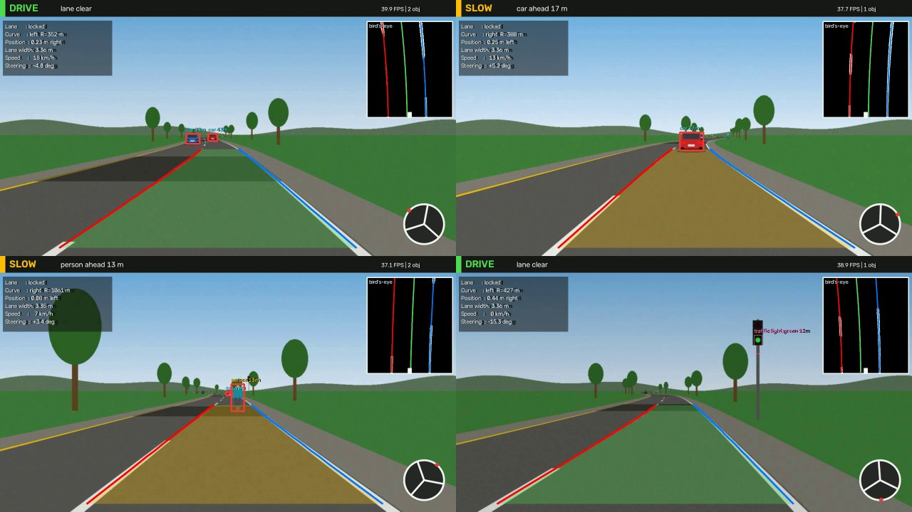

# Self-Driving Car – OpenCV + YOLO perception & decision demo

A complete, runnable mini self-driving stack:

* **Lane detection** with classical OpenCV (colour/gradient thresholds, bird's-eye
  perspective warp, sliding-window polynomial fit) → lane curvature, vehicle
  offset, lane width.
* **Object detection** with **YOLOv8** (cars, trucks, people, traffic lights,
  stop signs) + monocular **distance estimation** + traffic-light colour
  classification.
* **Decision making**: rule-based planner (`DRIVE` / `SLOW` / `STOP`) and a
  **Stanley-controller** steering angle.
* **HUD overlay**: lane polygon, boxes with range, telemetry, steering wheel,
  bird's-eye mini-map.
* **Synthetic road video generator**, so it works out of the box (no footage
  needed) and gives **ground truth** for measuring accuracy.



📐 Architecture & diagrams: **[docs/ARCHITECTURE.md](docs/ARCHITECTURE.md)**

---

## 1. Requirements

* Python **3.10+** (developed on 3.12), Linux / macOS / Windows
* ~2 GB disk (mostly PyTorch). **No GPU needed** (YOLOv8-nano runs on CPU).

## 2. Build (install)

```bash
cd self-driving-car

# 1) create a virtual environment
python3 -m venv .venv            # Debian/Ubuntu: if this fails, `sudo apt install python3-venv`
source .venv/bin/activate        # Windows: .venv\Scripts\activate

# 2) install dependencies
#    CPU-only PyTorch first (much smaller than the default CUDA build):
pip install torch torchvision --index-url https://download.pytorch.org/whl/cpu
pip install -r requirements.txt

# 3) download the YOLOv8-nano weights (6.5 MB) – skipped if already in models/
mkdir -p models
curl -L -o models/yolov8n.pt \
  https://github.com/ultralytics/assets/releases/download/v8.3.0/yolov8n.pt
```

> Don't need YOLO? Install only `opencv-python numpy` – the sample video uses the
> classical detector, which has no PyTorch dependency (YOLO is imported lazily).

## 3. Run

### 3a. Sample video (synthetic)

```bash
python generate_sample_video.py          # writes data/sample_road.mp4 (+ .truth.json), ~90 s
python main.py                           # opens a window  (q/ESC quit, space pause)
python main.py --no-display -o output/demo.mp4     # head-less: save annotated video
```

The 28-second scenario: cruise → catch up with a slower lead car (SLOW) →
a pedestrian crosses (STOP) → red traffic light (STOP) → green (DRIVE), all on a
road with left and right bends, tree shadows and lighting changes.

### 3b. Six real dash-cam videos (download into `data/real/`)

Real highway / road footage from Udacity's public self-driving-car repositories
(MIT licence, © Udacity, Inc.: `CarND-Advanced-Lane-Lines` and `CarND-LaneLines-P1`).
The videos are **not stored in this repo**: download them into `data/real/` (sources and
file names in [THIRD_PARTY.md](THIRD_PARTY.md)). Each has a ready-made calibration in
`data/real/presets.json`, which `main.py` loads automatically, so this just works:

```bash
python main.py --source data/real/project_video.mp4              # opens a window, YOLO on
python main.py --source data/real/solid_white_right.mp4 --no-display -o output/white.mp4
```

| Video | Size / length | Scene | Lane tracking (measured) |
|---|---|---|---|
| `project_video.mp4` | 1280×720, 50 s | highway, gentle bends, shadows | **99.4 %** locked |
| `solid_white_right.mp4` | 960×540, 9 s | straight highway, dashed + solid white | **100 %** |
| `solid_yellow_left.mp4` | 960×540, 27 s | straight highway, yellow edge line | **100 %** |
| `challenge_p1.mp4` | 1280×720, 10 s | bend with cars alongside | **99.6 %** |
| `challenge_video.mp4` | 1280×720, 16 s | concrete barrier, faded paint, bridge shadow | 63 % locked, 22 % coasting, 15 % lost |
| `harder_challenge_video.mp4` | 1280×720, 48 s | winding forest road, glare, sharp bends | 58 % locked, 29 % coasting, 12 % lost |

The last two are deliberately hard. Classical thresholding plus a polynomial
lane model struggles with them (sharp curves, glare, low-contrast paint); the
HUD then shows `coasting` / `lane lost` and the planner falls back to `SLOW`.
That is a limitation of this approach (a learned lane model would help), not a
bug in the data. "Locked" = a valid, plausible fit this frame; "coasting" = re-using the
last good fit; "lost" = no model.

Run all six in one go (head-less, writes `output/<name>.mp4`):

```bash
for v in data/real/*.mp4; do
  python main.py --source "$v" --no-display --detect-every 2 -o "output/$(basename "$v")"
done
```

### 3c. Your own dash-cam video (YOLO)

```bash
python main.py --source my_dashcam.mp4 --detector yolo --focal 1000 \
    --src-roi 585 460 695 460 1127 720 203 720 --roi-length-m 30 \
    --no-display -o output/mine.mp4
```

Two things must be calibrated for a new camera (otherwise results look off):

| Flag | Meaning | How to choose |
|---|---|---|
| `--src-roi x1 y1 x2 y2 x3 y3 x4 y4` | Trapezoid on the road in **pixels** (top-left, top-right, bottom-right, bottom-left). | Pick a *straight* road frame; the trapezoid corners should sit on the two lane lines (near the car, and far ahead). Success = lane lines are parallel and vertical in the mini-map. |
| `--roi-length-m` | Real length of road the trapezoid covers (m). | Dashed lane marks are 3 m (US) with 9 m gaps; ~30 m is typical. |
| `--focal` | Camera focal length in pixels. | `f ≈ width / (2·tan(HFOV/2))`; ~1000–1200 for a 1280-wide dash-cam. Only affects the distance estimate. |

**Check your calibration visually** with the helper (no guessing):

```bash
python calibrate.py --source my_dashcam.mp4 --frame 40 \
    --src-roi 585 460 695 460 1127 720 203 720 -o output/calib.png
```

It saves the frame with your trapezoid next to the bird's-eye view. On a straight
road both lane lines must be **vertical, parallel and on the green guides**; if they
splay outwards, shrink the trapezoid top, if they lean inwards, widen it.
Once happy, add your numbers to `data/real/presets.json` (key = file name) and
they are picked up automatically.

### 3d. Webcam

```bash
python main.py --source 0 --detector yolo
```

### All options

```
--source PATH|INDEX   video file or webcam index          (default data/sample_road.mp4)
-o, --output FILE     save annotated mp4
--no-display          head-less mode
--detector            auto | yolo | classical | none      (auto: classical for the sample, YOLO otherwise)
--weights FILE        YOLO weights                        (default models/yolov8n.pt)
--conf FLOAT          YOLO confidence threshold           (default 0.35)
--focal PIXELS        camera focal length for distances
--detect-every N      run detection every N frames (speed-up)
--max-frames N        stop after N frames
--src-roi / --roi-length-m   perspective calibration (see above)
```

### Reading the HUD

| Element | Meaning |
|---|---|
| Top banner | planner state (green DRIVE / amber SLOW / red STOP) and the reason |
| Left panel | lane lock, curve direction + radius, position in lane, lane width, commanded speed and steering angle |
| Coloured lane | detected ego lane (colour = state); red/blue lines = left/right boundary |
| Boxes | detections with range; **thick red** = in our path |
| Steering wheel | rotated by the steering command (exaggerated ×12 for visibility) |
| Top-right inset | bird's-eye mask with fitted lines (red/blue) and lane centre (green) |

## 4. Test & evaluate

```bash
pytest -q                 # 14 tests: geometry, lane accuracy, planner rules, end-to-end
python evaluate.py        # lane module vs simulator ground truth
```

Typical output on the sample video:

```
lane detected         : 100.0 %
offset error  (MAE)   : 5.6 cm
curvature corr. (r)   : 0.964
```

## 5. Project layout

```
self-driving-car/
├── main.py                  CLI: video I/O + display loop
├── generate_sample_video.py renders data/sample_road.mp4
├── evaluate.py              accuracy vs ground truth
├── calibrate.py             visual check of a perspective trapezoid
├── requirements.txt
├── src/
│   ├── config.py            camera / lane / driving parameters
│   ├── road_simulator.py    synthetic road renderer (+ ground truth)
│   ├── lane_detection.py    OpenCV lane pipeline
│   ├── object_detection.py  YOLO + classical detectors, distance, light colour
│   ├── decision.py          planner (DRIVE/SLOW/STOP) + Stanley steering
│   ├── visualization.py     HUD / overlay drawing
│   └── pipeline.py          wires the modules together
├── tests/test_pipeline.py
├── docs/ARCHITECTURE.md     diagrams + design explanation
├── data/
│   ├── sample_road.mp4      synthetic sample (generated)
│   └── real/                6 real dash-cam videos + presets.json (calibrations)
├── models/                  YOLO weights
└── output/                  annotated results
```

## 6. Troubleshooting

| Problem | Fix |
|---|---|
| `ensurepip is not available` | `sudo apt install python3-venv` (or `python3 -m venv --without-pip .venv` and bootstrap pip with `get-pip.py`) |
| `cannot open 'data/sample_road.mp4'` | run `python generate_sample_video.py` first |
| No window appears / `cv2.imshow` error over SSH | add `--no-display -o output/demo.mp4` |
| `libGL.so.1` import error | `pip install opencv-python-headless` instead of `opencv-python` (then use `--no-display`) |
| Lane overlay is skewed on my video | calibrate `--src-roi` and `--roi-length-m` (section 3b) |
| Too slow | `--detect-every 3`, or a smaller input video |
| Wrong distances | set `--focal` for your camera |

## 7. Limitations

Educational project, **not** for real vehicles: flat-road assumption, calibrated
camera needed, monocular distance, rule-based planning, no object tracking or
motion prediction. See the extension ideas in `docs/ARCHITECTURE.md`.

## License

AGPL-3.0, see [LICENSE](LICENSE). Third-party components and data: [THIRD_PARTY.md](THIRD_PARTY.md).
