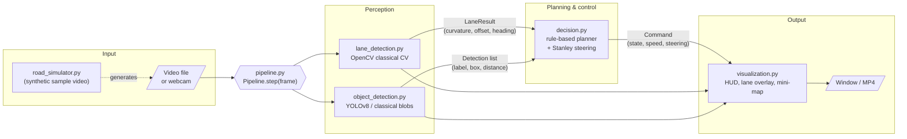
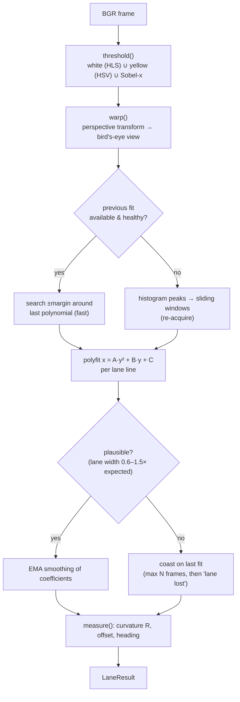
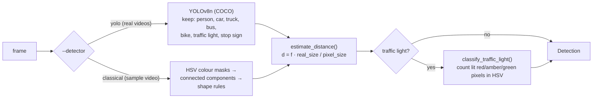
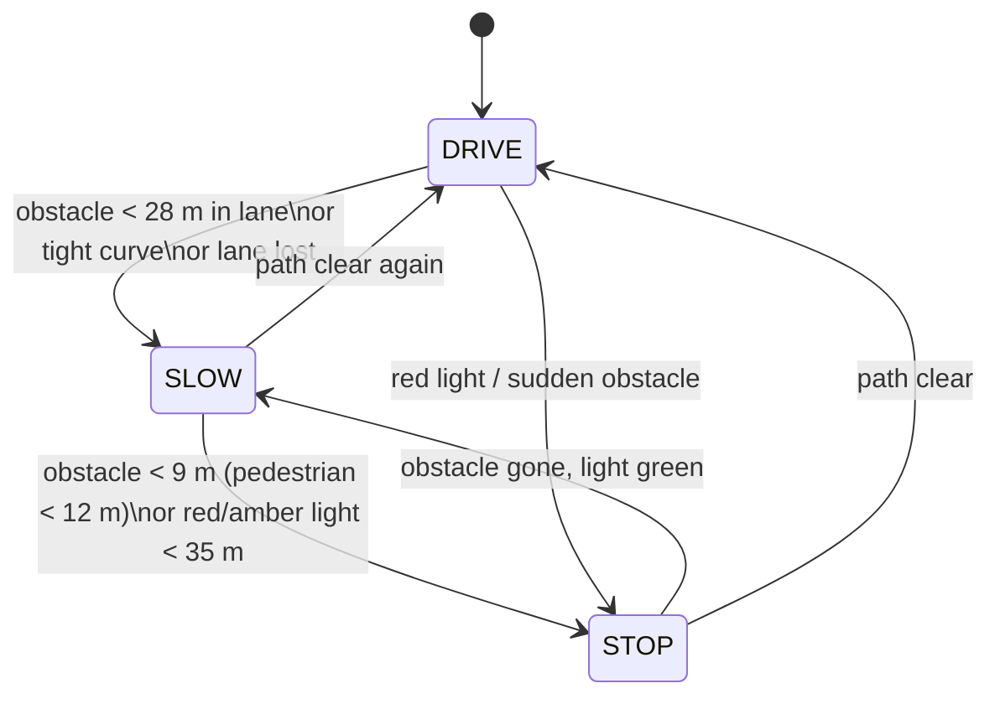
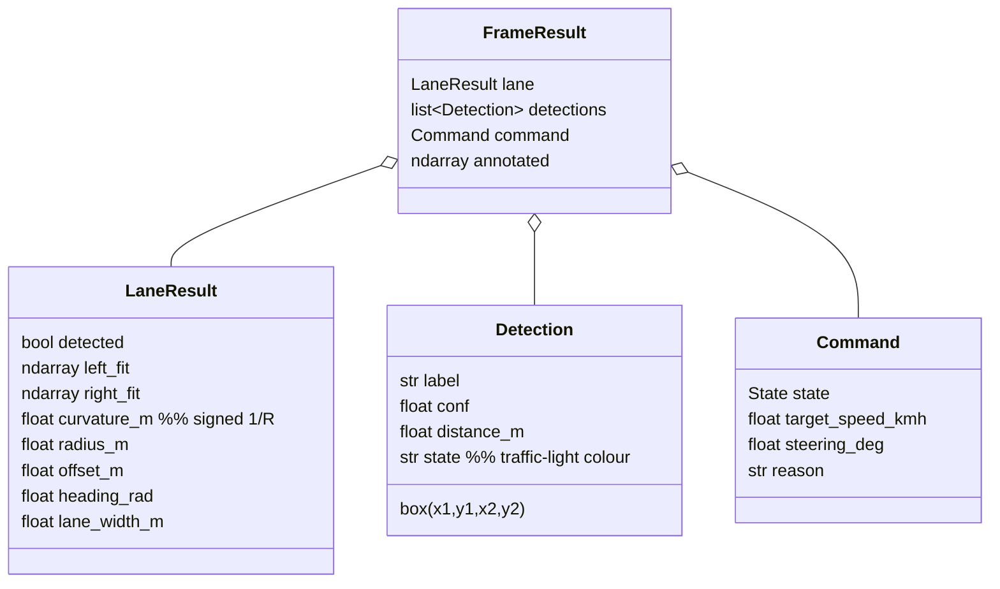
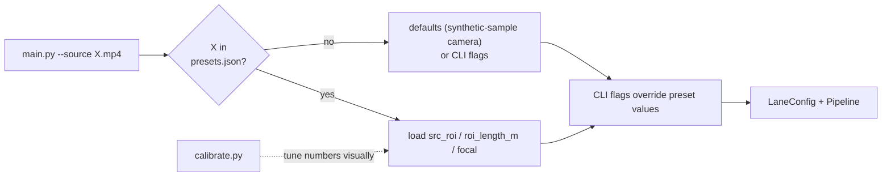

# Architecture

This document explains **how the system is put together and why**. Diagrams are
written in [Mermaid](https://mermaid.js.org/) (rendered automatically by GitHub,
VS Code with the Mermaid extension, and most Markdown viewers). An ASCII
version of the main diagram is included for plain-text viewers.

---

## 1. The big picture

A self-driving stack is usually described as **Perceive → Plan → Act**. This
project implements the first two stages fully and *simulates* the third (the
"actuator" is the steering-wheel / speed readout on the HUD).



ASCII version:

```
 ┌────────────┐   frame    ┌──────────────────────────── Pipeline.step() ───────────────────────────┐
 │ video/cam  │──────────▶ │                                                                         │
 └────────────┘            │  ┌─────────────────┐  LaneResult   ┌──────────────┐  Command           │
      ▲                    │  │ LaneDetector    │──────────────▶│              │──────────┐         │
      │ generates          │  │ (OpenCV)        │               │ Driving      │          ▼         │   annotated
 ┌────────────┐            │  └─────────────────┘               │ Planner      │   ┌────────────┐   │   frame
 │ road_      │            │  ┌─────────────────┐  Detections   │ (rules +     │   │ visual-    │───┼──────────▶ window / mp4
 │ simulator  │            │  │ Detector        │──────────────▶│  Stanley)    │   │ ization    │   │
 └────────────┘            │  │ YOLO | classical│               └──────────────┘   └────────────┘   │
                           │  └─────────────────┘                                                   │
                           └─────────────────────────────────────────────────────────────────────────┘
```

## 2. Module responsibilities

| Module | Responsibility | Key inputs → outputs | Depends on |
|---|---|---|---|
| `config.py` | All tunables in frozen dataclasses (camera, lane geometry, driving limits) | – | – |
| `road_simulator.py` | Renders the synthetic drive + ground-truth JSON | time `t` → BGR frame | `config` |
| `lane_detection.py` | Finds the ego lane, curvature and offset | frame → `LaneResult` | `config` |
| `object_detection.py` | Detects cars / people / lights, estimates range | frame → `list[Detection]` | – |
| `decision.py` | Chooses DRIVE / SLOW / STOP and a steering angle | `LaneResult` + detections → `Command` | `lane_detection`, `object_detection` |
| `visualization.py` | Draws everything (pure drawing, no logic) | frame + results → image | all result types |
| `pipeline.py` | Wires the modules; owns per-frame timing | frame → `FrameResult` | all |
| `main.py` | CLI, video I/O, display loop, loads `data/real/presets.json` calibrations | args → window / mp4 | `pipeline` |
| `calibrate.py` | Offline helper: shows a trapezoid + its bird's-eye warp to tune `--src-roi` | video + ROI → PNG | `lane_detection` |

**Design principles**

* **One-way data flow.** Perception modules never call the planner; the planner
  never draws. Each module can be tested alone (see `tests/`).
* **Typed hand-off objects.** `LaneResult`, `Detection`, `Command` are plain
  dataclasses – the only things that cross module boundaries.
* **Swappable detector.** `YoloDetector` and `ClassicalDetector` share one
  `detect(frame)` interface (a `typing.Protocol`), so adding e.g. an ONNX or
  TensorRT backend means writing one class.
* **Config, not magic numbers.** Calibration constants live in `config.py` or
  on the command line.

## 3. Lane-detection pipeline (OpenCV)



**Why a bird's-eye view?** In the camera image parallel lane lines converge
towards the horizon, so their pixel distance means different real distances
at different rows. After the homography, lane lines are (almost) parallel,
vertical and the pixel↔metre scale is constant, which makes polynomial fitting
and curvature maths simple.

**Curvature maths.** With the centre-line `x(y) = A·y² + B·y + C` converted to
metres, `κ = x'' / (1 + x'²)^{3/2}`, `R = 1/|κ|`. Sign: `+` = bends right.

**Vehicle offset.** The camera sits at the image centre, so
`offset = (image_centre − lane_centre) × metres_per_pixel`; `+` means the car is
right of the lane centre.

## 4. Object detection & distance



*Why two detectors?* The sample video is made of flat cartoon sprites that a
COCO-trained network does not recognise (we measured: it misses the cars and
hallucinates stop signs). The classical detector understands exactly those
sprites. On any real footage use YOLO.

*Monocular distance.* With a pin-hole camera, an object of real size `S` that
appears `s` pixels large is at `d = f·S/s`. It is an estimate (assumes typical
car width 1.85 m, person height 1.7 m …) but good enough for braking rules.

## 5. Decision making

> Note: the diagram below shows the *possible states*. In the code the state is **not** a stateful machine: every frame all rules are re-evaluated from scratch and the most restrictive outcome wins (STOP > SLOW > DRIVE). Only the actuation values (speed, steering) keep memory, for rate limiting. See the PDF guide for the exact priority logic.



*In-path test:* an object counts only if its ground-contact point (bottom-centre
of the box) is inside the **detected lane polygon** (projected to the
bird's-eye view and compared against both lane polynomials, with a margin for
pedestrians). Beyond the warped region we fall back to a central image corridor.

*Steering (Stanley controller):*

```
δ = heading_error  +  atan( k · cross_track_error / v )  +  atan( wheelbase · κ )
        │                         │                               │
  align with lane          pull back to centre             anticipate the bend
```

Output is clamped (±35°) and rate-limited (60°/s); speed uses acceleration and
braking limits – so the HUD behaves like a real car rather than jumping.

## 6. Data model



## 7. Synthetic road simulator

`road_simulator.py` renders every frame from first principles instead of using
a stock video:

1. For each image row below the horizon the flat-ground pin-hole model gives
   the forward distance `z = f·h / (y − y_horizon)`; each column gives the
   lateral ground position `X = (x − cx)·z / f`.
2. The road is defined by a *world* curvature profile κ(Z); the camera follows it
   and sees a sideways shift of ≈ ½κz² for points `z` metres ahead.
3. Pixels are coloured by `X` (yellow edge, dashed white divider, white edge,
   gravel, grass), with texture noise, shadows and exposure changes.
4. Cars, a walking pedestrian, trees and a traffic light are sprites scaled by
   `f / z` and painted far-to-near.
5. The true offset and curvature of every frame are written to
   `sample_road.truth.json`; `evaluate.py` and the tests use them to measure
   the lane detector's accuracy.

## 8. Performance

Measured on a 20-core CPU (no GPU), 1280×720:

| Configuration | Throughput |
|---|---|
| Lane + classical detector (sample video) | ≈ 38 FPS |
| Lane + YOLOv8n (real video) | ≈ 22 FPS |

Use `--detect-every 2` or `3` to run YOLO on every 2nd/3rd frame (the last
detections are re-used), which roughly doubles/triples throughput.

## 9. Real-world videos & calibration

`data/real/` holds six public dash-cam clips. A camera needs three numbers that
the code cannot know: the road trapezoid (`src_roi`), the road length it covers
(`roi_length_m`) and the focal length in pixels (`focal`). They are stored per
video in `presets.json`; the flow is:



Measured lane-lock rate on the six videos: 99–100 % on four, and 58–63 % on the
two hardest ones (sharp curves, glare, faded paint), which is the practical
limit of a classical threshold-and-polynomial lane model.

## 10. Known limitations / extension ideas

* Lane model assumes a roughly flat road and a **calibrated trapezoid**
  (`--src-roi`) – a camera-pose change needs re-calibration.
* Distance is monocular and assumes known object sizes.
* The planner is rule-based; it does not predict other agents' motion.
* Ideas: camera undistortion, Kalman-filter object tracking (stable IDs,
  relative speed → time-to-collision), a learned lane model (e.g. UFLD),
  closed-loop simulation with CARLA.
